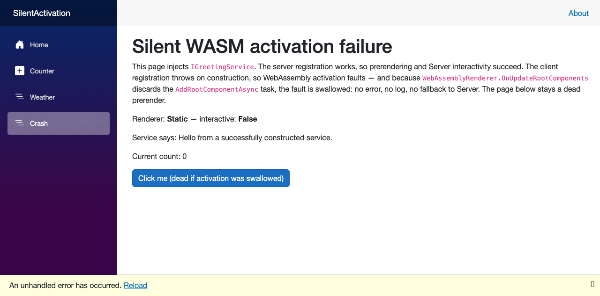

# repro: Blazor swallows WASM root-component activation failures

Blazor Web App (.NET 10, per-page `InteractiveAuto`) demonstrating that an exception thrown
during WebAssembly root-component activation is **silently discarded** — no console error, no
`blazor-error-ui`, no log — and Auto mode never falls back to Server, leaving the page a dead
prerender forever.

Cause: `WebAssemblyRenderer.OnUpdateRootComponents` fire-and-forgets the activation tasks
(`_ = webRootComponentManager.AddRootComponentAsync(...)`), see
[`WebAssemblyRenderer.cs` (release/10.0)](https://github.com/dotnet/aspnetcore/blob/release/10.0/src/Components/WebAssembly/WebAssembly/src/Rendering/WebAssemblyRenderer.cs#L72-L84).

Issue text: [ISSUE.md](ISSUE.md).

## Delta vs. the SDK template

The app is an unmodified `dotnet new blazor -n SilentActivation -int Auto` (SDK 10.0.302)
plus only what the repro needs:

| File | Change |
|---|---|
| `SilentActivation.Client/GreetingService.cs` | **new** — service interface + working implementation |
| `SilentActivation.Client/Pages/Crash.razor` | **new** — `InteractiveAuto` page injecting the service |
| `SilentActivation.Client/Program.cs` | register `IGreetingService` with a throwing factory; add a `FirstChanceException` console logger (observation only — it is the sole way to see the swallowed exception) |
| `SilentActivation/Program.cs` | register the working `IGreetingService` implementation |
| `SilentActivation/Components/Layout/NavMenu.razor` | add the Crash nav link (the enhanced-navigation trigger) |
| `SilentActivation.Client/Pages/Counter.razor` | one added line showing `RendererInfo` so you can tell when Auto has committed to WASM |

Everything else (solution GUIDs, launch ports) is scaffold output.

## Setup

`IGreetingService` is registered **working on the server** and with a **throwing factory in the
WASM client** (`SilentActivation.Client/Program.cs`) — simulating any dependency whose
construction only fails on the WebAssembly runtime (type-initializer failure, trimming, …).
The `/crash` page (`InteractiveAuto`) injects it.

## Reproduce

```bash
dotnet run --project SilentActivation --launch-profile http
```

1. Open http://localhost:5282/counter — first interactive visit renders on **Server**.
2. Bounce Home ↔ Counter until Counter shows **WebAssembly** (Auto has committed to WASM).
3. Click the **Crash** nav link (enhanced navigation).

## Observed (.NET SDK 10.0.302)

- `/crash` stays `Renderer: Static — interactive: False` forever; the button is dead.
- **No error surfaces anywhere.** The only way to see the exception is the
  `FirstChanceException` hook in the client `Program.cs`.
- No fallback to Server, although the server renders this page fine (the prerender proves it).
- A **full page reload** of `/crash` is equally dead: with the WASM runtime cached, Auto
  commits to WebAssembly again and the activation dies the same way. No user-side recovery
  short of clearing the browser cache.


